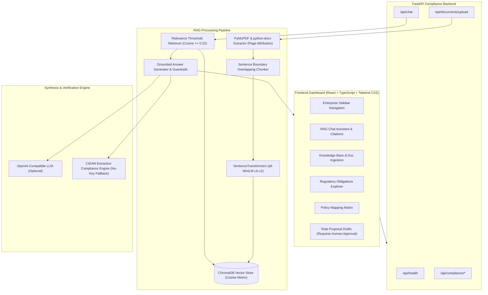

# CIDAN — Compliance Intelligence & Dynamic Adaptation Network

CIDAN is an enterprise banking regulatory compliance RAG (Retrieval-Augmented Generation) assistant. It empowers bank compliance officers, risk managers, and auditors to ingest regulatory circulars, extract binding obligations, evaluate internal bank policy alignments, and prepare auditable proposed rule amendments with traceable evidence.

---

## 🌐 Live Production Deployments

* **Frontend Web Application (Vercel):** [https://cidan.vercel.app](https://cidan.vercel.app)
* **Backend Cloud API (Render):** [https://cidan-rag.onrender.com](https://cidan-rag.onrender.com)
* **Interactive API Documentation:** [https://cidan-rag.onrender.com/docs](https://cidan-rag.onrender.com/docs)
* **Backend Telemetry & Health Check:** [https://cidan-rag.onrender.com/api/health](https://cidan-rag.onrender.com/api/health)

---

## 1. System Architecture



---

## 2. Core Functional Distinctions

CIDAN strictly categorizes all output information into explicit compliance tiers:

1. **Retrieved Facts (Ground Truth)**: Verbatim, audited factual requirements traced directly to indexed circular passages and page numbers.
2. **AI-Generated Suggestions**: Analytical advisory insights and practical implementation recommendations.
3. **Items Requiring Human Verification**: Explicitly highlighted compliance checks requiring mandatory sign-off from the Compliance Officer, Legal Counsel, or Board Risk Committee.
4. **Proposed Rule Changes (Drafts)**: Policy redline proposals explicitly tagged as `DRAFT - Requires Human Approval`. Rules are never auto-activated.
5. **Insufficient Evidence Fallback**: If retrieved passages do not satisfy the similarity threshold (Cosine ≥ 0.22), CIDAN strictly responds:
   > *"I couldn't find sufficient supporting evidence in the indexed documents to answer this confidently."*

---

## 3. Technology Stack

### Frontend:
- **Framework**: React 19 with Vite 8
- **Language**: TypeScript
- **Styling**: Tailwind CSS v4 (Enterprise banking palette: Deep Navy `#0A2540`, Teal accents, clean light-blue backgrounds)
- **Icons**: Lucide React
- **HTTP**: Fetch API with automated dev-proxy to FastAPI backend

### Backend:
- **Runtime**: Python (FastAPI + Pydantic v2)
- **Server**: Uvicorn ASGI
- **Vector Database**: ChromaDB (persistent on-disk storage with cosine indexing)
- **Embedding Model**: SentenceTransformers (`all-MiniLM-L6-v2`, 384-dimensional normalized vectors)
- **Document Extractors**: PyMuPDF (`pymupdf`) for PDF text extraction with page numbers, `python-docx` for Word documents
- **Testing**: PyTest with FastAPI `TestClient`

---

## 4. Security & Compliance Guardrails

- **Untrusted Document Boundaries**: Uploaded document content is strictly encapsulated as untrusted evidentiary data. System prompt defenses isolate user documents from executable model instructions.
- **No Direct System Modification**: CIDAN does not connect to core transactional banking rails or automatically enforce compliance rules.
- **Draft Status Required**: All rule proposals remain drafts requiring human sign-off before adoption.
- **Data Privacy**: Vector embeddings and document metadata persist in local directories (`backend/data/`). No document text or API credentials are logged or exposed to the frontend.

---

## 5. Getting Started (Windows PowerShell Commands)

### Prerequisites:
- Python 3.10+ (tested and verified on Python 3.14.5)
- Node.js 18+ (tested and verified on v26.3.0 / npm 11.16.0)

### Step 1: Install Backend Dependencies
Open PowerShell in the project directory:
```powershell
cd d:\cidan-rag-chatbot\backend
python -m pip install -r requirements.txt
```

### Step 2: Configure Environment (Optional OpenAI Key)
Copy the example environment configuration:
```powershell
cp .env.example .env
```
To enable OpenAI-compatible LLM generation, set your API key in `backend/.env`:
```ini
OPENAI_API_KEY=sk-your-key-here
OPENAI_BASE_URL=https://api.openai.com/v1
OPENAI_MODEL=gpt-4o-mini
```
> **Note:** If `OPENAI_API_KEY` is omitted, CIDAN automatically runs in **Extractive Grounding Mode**, extracting verified facts, citations, and compliance recommendations locally without calling external APIs.

### Step 3: Run Backend Tests
Run the automated test suite verifying health checks, text chunking, retrieval, citation metadata, and insufficient-evidence handling:
```powershell
python -m pytest tests -v
```

### Step 4: Start the Backend Service
Start the FastAPI backend with hot reloading on port 8000:
```powershell
python -m uvicorn app.main:app --host 127.0.0.1 --port 8000 --reload
```
The backend will initialize, connect to ChromaDB, and automatically seed synthetic test fixtures if the database is empty.

### Step 5: Start the Frontend Application
Open a new PowerShell window:
```powershell
cd d:\cidan-rag-chatbot\frontend
npm install
npm run dev
```
Navigate your browser to: **http://localhost:5173**

---

## 6. Pre-Indexed Synthetic Test Fixtures

CIDAN comes pre-configured with two clearly labeled synthetic fixtures for demonstration:
1. `SYNTHETIC_CIRCULAR_CB_2024_09.docx`:
   - *Label*: `[SYNTHETIC TEST FIXTURE - NOT A REAL REGULATORY CIRCULAR]`
   - *Topic*: Central Bank Prudential Liquidity & Operational Resilience Framework
   - *Provisions*: LCR minimum 105%, RTO < 4 hours for critical cloud services, CRO Board reporting cadence.
2. `SYNTHETIC_BANK_POLICY_POL_TREAS_04.docx`:
   - *Label*: `[SYNTHETIC TEST FIXTURE - INTERNAL BANK POLICY]`
   - *Topic*: Wholesale Funding & Liquidity Risk Management Policy (Current 100% LCR baseline)

---

## 7. API Reference

| Method | Endpoint | Description |
|---|---|---|
| `GET` | `/api/health` | Backend telemetry, ChromaDB status, embedding model status, and indexed chunk count. |
| `POST` | `/api/documents/upload` | Ingest PDF or DOCX file, extract text, split into overlapping chunks, embed, and index in ChromaDB. |
| `GET` | `/api/documents` | List indexed documents, file sizes, page counts, chunk counts, and statuses. |
| `DELETE` | `/api/documents/{doc_id}` | Remove document and all related chunk embeddings from vector storage. |
| `POST` | `/api/chat` | Retrieve evidence passages and generate grounded answer with citations and fact/suggestion separation. |
| `GET` | `/api/chat/suggestions` | Suggested exploration prompts and dynamic queries based on indexed documents. |
| `GET` | `/api/compliance/obligations` | List extracted circular obligations with risk rating, deadline, and compliance status. |
| `GET` | `/api/compliance/policy-mappings` | Cross-reference matrix comparing circular clauses against internal bank policies. |
| `GET` | `/api/compliance/rule-drafts` | Draft rule proposals requiring authorized human review. |
| `POST` | `/api/compliance/rule-drafts/{id}/action` | Submit compliance officer review action (Approve, Request Legal Review, Reject). |

---

## 8. Known Limitations & Next Steps

1. **OCR for Scanned PDFs**: Current PyMuPDF extraction parses digital text layers. Future iterations could integrate Tesseract OCR for scanned physical gazettes.
2. **Multi-Jurisdiction Cross-Referencing**: Expanding beyond single circulars to cross-reference multiple regulatory bodies (e.g., Basel Committee, OCC, EBA, MAS) simultaneously.
3. **Automated Redline Word Export**: Generating ready-to-sign Word docx redline exports directly from the Rule Drafts approval panel.
